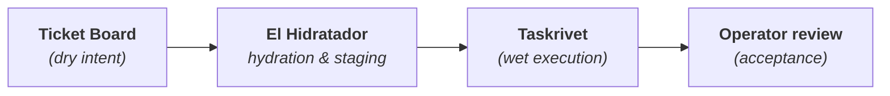

# El Hidratador

[](https://github.com/hamanakam1/el-hidratador/actions/workflows/ci.yml)
[](https://github.com/hamanakam1/el-hidratador/actions/workflows/lint.yml)
[](LICENSE)
[](https://www.python.org/)
[](pyproject.toml)

```text
                     .
                    / \
                   / _ \
                  | (_) |
                 /`     `\
                /  DRY    \
               |   INTENT  |
               |===========|
               | .   ~  .  |       E L   H I D R A T A D O R
               | : W E T : |       ───────────────────────────────────────────────────────
               | :STAGED : |       [dry ticket] ──► context expansion ──► [wet execution]
               | :~~~~~~~: |       ordered DAGs • locked sandboxes • routed compute profile
               \___________/       ───────────────────────────────────────────────────────
```

**The Context Expansion and Execution Staging Engine.**

El Hidratador is the bridge between human-approved intent and deterministic machine action. It
turns a *dry* semantic ticket — fifty words of intent — into *wet* execution state: expanded
context, an ordered execution DAG, a locked sandbox specification, and a routed compute profile.

> **Pipeline position:** downstream from the Ticket Board, upstream from Taskrivet.



---

## Welcome

**If you are new here, start here.** Two commands, no setup, nothing to configure:

```bash
pip install el-hidratador

hidratador doctor    # is this machine ready?
hidratador demo      # watch a whole ticket lifecycle, narrated, on a scratch ledger
```

`demo` runs a ticket from `INBOX` to `DONE` in a temporary directory and explains each step as it
happens. It never touches your own ledger.

| If you want to… | Go to |
|------------------|-------|
| See it work in 60 seconds | [docs/getting-started.md](docs/getting-started.md) |
| Understand the vocabulary | [docs/glossary.md](docs/glossary.md) |
| Look up a term you just met | [docs/faq.md](docs/faq.md) |
| Install it your way | [docs/install.md](docs/install.md) |
| Fix something that stopped | [docs/troubleshooting.md](docs/troubleshooting.md) |
| Read the architecture | [docs/architecture.md](docs/architecture.md) |
| Learn every command | [docs/cli-reference.md](docs/cli-reference.md) |
| Work on the project | [docs/development.md](docs/development.md) |
| Ask a question or propose something | [docs/community.md](docs/community.md) |

---

## Badges

[](https://github.com/hamanakam1/el-hidratador/actions/workflows/ci.yml)
[](https://github.com/hamanakam1/el-hidratador/actions/workflows/lint.yml)
[](https://github.com/hamanakam1/el-hidratador/actions/workflows/codeql.yml)
[](https://github.com/hamanakam1/el-hidratador/actions/workflows/scorecard.yml)
[](https://github.com/hamanakam1/el-hidratador/actions/workflows/security-scan.yml)
[](https://pypi.org/project/el-hidratador/)
[](https://pypi.org/project/el-hidratador/)
[](LICENSE)
[](pyproject.toml)
[](https://docs.astral.sh/ruff/)
[](pyproject.toml)

---

## Why it exists

Autonomous execution fails in three predictable ways, and all three are context problems wearing a
costume:

1. **The worker starts with fifty words and a repository of four million.**
2. **Two workers touch the same resource and neither knows about the other.**
3. **Work is declared complete by the worker that performed it.**

El Hidratador is built around refusing those three failures:

| Failure | What El Hidratador does |
|---------|--------------------------|
| Underspecified execution | Expands a ticket into a byte-budgeted, self-describing instruction |
| Resource collision | Grants execution leases and refuses overlapping scope keys |
| Self-acceptance | Separates *finished* from *accepted*; only an operator accepts |

---

## The six guarantees

These hold for every code path in this repository:

1. **The core is standard library only.** No network, no shell execution, no telemetry.
2. **Nothing is accepted implicitly.** `finish()` creates `REVIEW`; only `decide(accept)` creates
   `DONE`.
3. **Eligibility is not authorization.** Routing can recommend a target and can never authorize one.
4. **Declared is not measured.** Token counts are reported by workers, never metered by a provider.
   `measured_cash_cost` is `null` on purpose.
5. **Context is untrusted reference data.** Attached context is quoted inside explicit banners and
   never treated as an instruction.
6. **Every refusal is visible.** Conflicts, budget stops, stagnation, and omitted context are
   reported, not swallowed.

---

## The five-minute path

```bash
# 1. Create the ledger
hidratador init

# 2. Describe the work
hidratador task-add M-1001 \
  --objective "Implement JWT-based authentication" \
  --acceptance "Issuance, refresh rotation, and revocation all work" \
  --scope repo/api --scope repo/auth \
  --tags security,auth \
  --budget 8000

# 3. Triage it into the ready queue
hidratador triage M-1001

# 4. Take the lease
hidratador start M-1001 --owner terminal-1 --lease 900
# → {"session_id": "…", "lease_until_iso": "…"}

# 5. Record evidence as you go
hidratador checkpoint <session-id> \
  --summary "Implemented token issuance" \
  --evidence "diff 4f2a1c; POST /api/auth/login returns an access+refresh pair" \
  --next "Refresh rotation" \
  --tokens 1200

# 6. Request review
hidratador finish <session-id> --evidence "All endpoints tested; diff 4f2a1c"

# 7. An operator accepts
hidratador decide M-1001 accept --reason "Reviewed the diff and the tests"
# → {"status": "DONE"}
```

Every command prints exactly one JSON object. Nothing else is written to stdout.

---

## Core concepts

| Concept | Description |
|---------|-------------|
| **Bounded context** | Every ticket carries an objective, acceptance criteria, scope keys, and a token budget |
| **Explicit ownership** | `start()` acquires a lease; an expired lease blocks the task until reconciliation |
| **Resource scope** | Tickets reserve scope keys; two tickets with overlapping scope cannot run at once |
| **Evidence at every step** | `checkpoint()` requires summary, evidence, next step, and cumulative tokens |
| **Cumulative budget** | Token budgets survive retries; tokens never decrease |
| **Stagnation detection** | Three checkpoints with identical evidence block the task as `no_progress` |
| **Acceptance ≠ execution** | `finish()` → `REVIEW` → operator `decide(accept)` → `DONE` |
| **Failure fingerprints** | `sha256(category:summary)[:16]` groups recurring failures |

### Lifecycle

```text
INBOX → READY → IN_PROGRESS ⇄ BLOCKED → REVIEW → ACCEPTED → DONE
             ↑__________|___________|
                 retry (tokens preserved)
```

| Station | Entered when | Left when |
|---------|--------------|-----------|
| `INBOX` | The ticket is created | It is triaged |
| `READY` | Scope and budget are defined | A lease is acquired |
| `IN_PROGRESS` | `start()` succeeded | A checkpoint, a failure, or lease expiry |
| `BLOCKED` | Lease expired, budget exhausted, no progress, or an explicit failure | `decide(retry)` or cancellation |
| `REVIEW` | `finish()` was called with evidence | An operator decides |
| `ACCEPTED` | `decide(accept)` | Immediately transitions to `DONE` |
| `DONE` | Accepted work | Immutable |

---

## Architecture

```text
                    ┌───────────────────────────────────────────┐
   Ticket Board ──► │  core.Ledger  (SQLite, WAL, event log)    │
   (dry intent)     │  tasks · sessions · checkpoints · failures │
                    └───────────────┬───────────────────────────┘
                                    │
        ┌───────────────────────────┼───────────────────────────┐
        ▼                           ▼                           ▼
 context_expander              dag.build_dag              hardware_router
 budgeted prompt,            ordered nodes,              eligibility only,
 untrusted context           manifest, waves             never authorization
        │                           │                           │
        └───────────────┬───────────┴───────────┬───────────────┘
                        ▼                       ▼
                 sandbox.build_sandbox    github_sync
                 read-only root,          observations + reconciled
                 scoped mounts           outbox
                        │                       │
                        └───────────┬───────────┘
                                    ▼
                         handoff → Taskrivet
                    (prepared state, not permission)
```

### Module map

| Module | Responsibility | Network |
|---------|----------------|---------|
| `core.py` | Ledger, lifecycle, leases, budgets, failures, events, handoffs | none |
| `errors.py` | Typed error taxonomy | none |
| `context_expander.py` | Context injection, byte budgets, prompt rendering | none |
| `dag.py` | Node parsing, topological ordering, manifests | none |
| `sandbox.py` | Sandbox specifications and the optional Docker adapter | adapter only |
| `hardware_router.py` | Compute classification and eligibility | none |
| `github_sync.py` | Observations, outbox, reconciliation | `gh` CLI only |
| `dashboard.py` | Local dashboard preview | loopback HTTP only |
| `tickets.py` | Portable file-backed ticket storage | none |
| `schema.py` | Published JSON Schemas and a dependency-free validator | none |
| `replay.py` | Rebuild a task's lifecycle from its event log | none |
| `doctor.py` | Environment checks | none |
| `demo.py` | The narrated demonstration | none |
| `cli.py` | JSON-first command line interface | none |

### Project layout

```text
el_hidratador/     the package: core plus adapters
tests/             192 tests, one file per area
docs/              the documentation you are reading
docs/adr/          architecture decision records
docs/wiki/         pages published to the GitHub wiki
examples/          a runnable walkthrough, a ticket, a config, a sandbox spec
schema/            the published JSON Schemas
templates/         ticket and checkpoint templates
scripts/           repository helpers
```

---

## Security boundaries

| Boundary | Rule |
|----------|------|
| **Core** | No network, no shell execution, no telemetry, standard library only |
| **Adapters** | Declare the supported version, permission model, and cancellation semantics |
| **Sandbox** | Read-only root filesystem, no network by default, all capabilities dropped |
| **Dashboard** | HTTP only, loopback only, no redirects, 8 MiB cap, 10 s timeout, no credentials in URL |
| **GitHub** | `gh` CLI only, no token ever read by this package, 30 s timeout, 16 MiB cap |
| **Secrets** | Never in the repository; injected through the environment at deploy time |

Local state is created with restrictive permissions: the ledger directory is `0700` and the ledger
file is `0600`. `hidratador doctor` checks all of it and reports what it finds without changing
anything.

See [SECURITY.md](SECURITY.md) for the reporting process and
[docs/security.md](docs/security.md) for the full model.

---

## Documentation

| Page | What it covers |
|------|----------------|
| [docs/index.md](docs/index.md) | Documentation home and reading order |
| [docs/adr/index.md](docs/adr/index.md) | The architecture decision records: what was decided, and what it cost |
| [docs/getting-started.md](docs/getting-started.md) | The five-minute path |
| [docs/glossary.md](docs/glossary.md) | Every domain term, defined once |
| [docs/faq.md](docs/faq.md) | Questions newcomers actually ask |
| [docs/install.md](docs/install.md) | Every install path |
| [docs/architecture.md](docs/architecture.md) | Layers, data model, end-to-end sequence |
| [docs/cli-reference.md](docs/cli-reference.md) | Every command, flag, and output key |
| [docs/context-and-packets.md](docs/context-and-packets.md) | Budgeting, priority, omission, untrusted context |
| [docs/dag-and-sandbox.md](docs/dag-and-sandbox.md) | Node parsing, ordering, manifest, sandbox spec |
| [docs/github-sync.md](docs/github-sync.md) | Observations, outbox, idempotency, reconciliation |
| [docs/failure-playbook.md](docs/failure-playbook.md) | Every failure category and its recovery path |
| [docs/troubleshooting.md](docs/troubleshooting.md) | Symptom, cause, fix |
| [docs/operations.md](docs/operations.md) | Day-to-day operation, backup, runbooks |
| [docs/development.md](docs/development.md) | How to work on the project |
| [docs/community.md](docs/community.md) | How to get help and how decisions are made |
| [docs/security.md](docs/security.md) | Trust model and boundaries |
| [docs/roadmap.md](docs/roadmap.md) | What is next, and what is explicitly not planned |
| [examples/walkthrough.md](examples/walkthrough.md) | A complete runnable session |

---

## Development

```bash
python3 -m pip install -e ".[dev]"

# Tests
python3 -m unittest discover -s tests -v

# Lint, format, types
ruff check el_hidratador/
ruff format --check el_hidratador/
mypy el_hidratador/

# Everything the CI runs
make check
```

There is also a [devcontainer](.devcontainer/devcontainer.json): open the repository in a container
and the toolchain is already installed.

Contributions are welcome. Read [CONTRIBUTING.md](CONTRIBUTING.md) first — the acceptance rules
there are the same rules the code follows, and [docs/development.md](docs/development.md) has the
step-by-step version.

---

## Repository features

| Feature | Where |
|---------|-------|
| Issue forms (bug, feature, question, docs, RFC, small task) | [New issue](https://github.com/hamanakam1/el-hidratador/issues/new/choose) |
| Discussion forms (introductions, ideas) | [Discussions](https://github.com/hamanakam1/el-hidratador/discussions) |
| Discussions | [github.com/hamanakam1/el-hidratador/discussions](https://github.com/hamanakam1/el-hidratador/discussions) |
| Wiki | [github.com/hamanakam1/el-hidratador/wiki](https://github.com/hamanakam1/el-hidratador/wiki) |
| Roadmap | [docs/roadmap.md](docs/roadmap.md) and the `roadmap` label |
| Releases | [github.com/hamanakam1/el-hidratador/releases](https://github.com/hamanakam1/el-hidratador/releases) |
| Security advisories | [SECURITY.md](SECURITY.md) |
| Published documentation | [hamanakam1.github.io/el-hidratador](https://hamanakam1.github.io/el-hidratador/) |
| Container image | `ghcr.io/hamanakam1/el-hidratador` |
| Devcontainer | [.devcontainer/devcontainer.json](.devcontainer/devcontainer.json) |
| Citation metadata | [CITATION.cff](CITATION.cff) |
| Build attestations and SBOM | attached to every release |

---

## License

MIT — see [LICENSE](LICENSE). Author: Michael Hamanaka.
